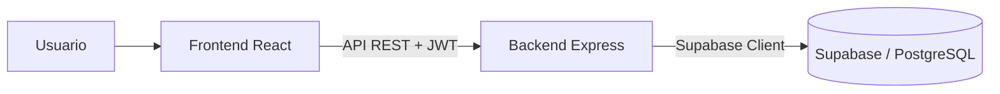

# XTREMEGYM

Aplicación web de demostración para administrar la operación diaria de un gimnasio: miembros, membresías, asistencia, inventario y ventas.

- **Demo:** https://xtremegymbga.vercel.app
- **Repositorio:** https://github.com/ErikSneyPlata/XTREMEGYM

## Qué permite hacer

- Iniciar sesión y trabajar con perfiles de administrador, encargado y entrenador.
- Consultar y administrar clientes y sus membresías.
- Registrar asistencia y consultar el historial de check-ins.
- Administrar planes y pagos de membresía.
- Gestionar productos, inventario y ventas desde el punto de venta.
- Consultar estadísticas, reportes de ingresos y actividad administrativa.

## Cómo funciona

La interfaz React consume una API REST desarrollada con Express. El backend utiliza Supabase para acceder a la base de datos PostgreSQL, valida las credenciales de acceso y entrega tokens JWT para las sesiones. El esquema de las tablas y las relaciones está documentado en [backend/schema.md](backend/schema.md).



## Tecnologías

- **Frontend:** React, Vite, React Router, Tailwind CSS, Axios y Recharts.
- **Backend:** Node.js, Express, Supabase JS, bcrypt y JSON Web Tokens.
- **Base de datos:** PostgreSQL administrado con Supabase.

## Estructura del proyecto

- `frontend/`: aplicación React, páginas, componentes, autenticación y cliente API.
- `backend/`: servidor Express, rutas, controladores, middleware y conexión a Supabase.
- `backend/schema.md`: documentación del modelo de datos.

## Requisitos

- Node.js y npm.
- Un proyecto PostgreSQL en Supabase.
- Las tablas creadas según la guía de [backend/schema.md](backend/schema.md).

## Ejecutar localmente

### 1. Configurar e iniciar el backend

Desde la raíz del repositorio:

```bash
cd backend
npm install
```

Crea `backend/.env` con las credenciales de tu proyecto y el origen permitido del frontend:

```dotenv
SUPABASE_URL=https://<tu-proyecto>.supabase.co
SUPABASE_KEY=<clave-del-backend>
FRONTEND_URL=http://localhost:5173
PORT=3000
```

Inicia la API:

```bash
npm start
```

El servidor expone `GET /health` para comprobar su disponibilidad.

### 2. Configurar e iniciar el frontend

En otra terminal, desde la raíz:

```bash
cd frontend
npm install
```

Crea `frontend/.env.local`:

```dotenv
VITE_API_URL=http://localhost:3000
```

Inicia la interfaz:

```bash
npm run dev
```

Vite muestra en la terminal la dirección local para abrir la aplicación.

## Configuración y seguridad

- Mantén `SUPABASE_KEY` en el entorno del backend; no la agregues al código del frontend ni al repositorio.
- Usa datos ficticios para demos y capturas.
- Antes de usar el sistema con información real, revisa que cada ruta sensible de la API compruebe autenticación y rol en el backend. La protección visual de una ruta en el frontend por sí sola no protege los datos.
- Configura `FRONTEND_URL` con el dominio exacto de la interfaz que debe acceder a la API.
